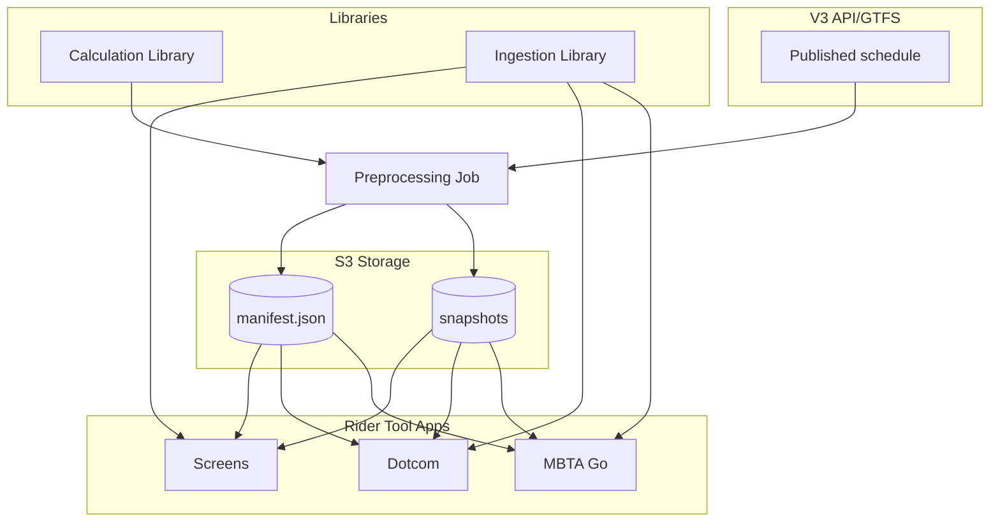
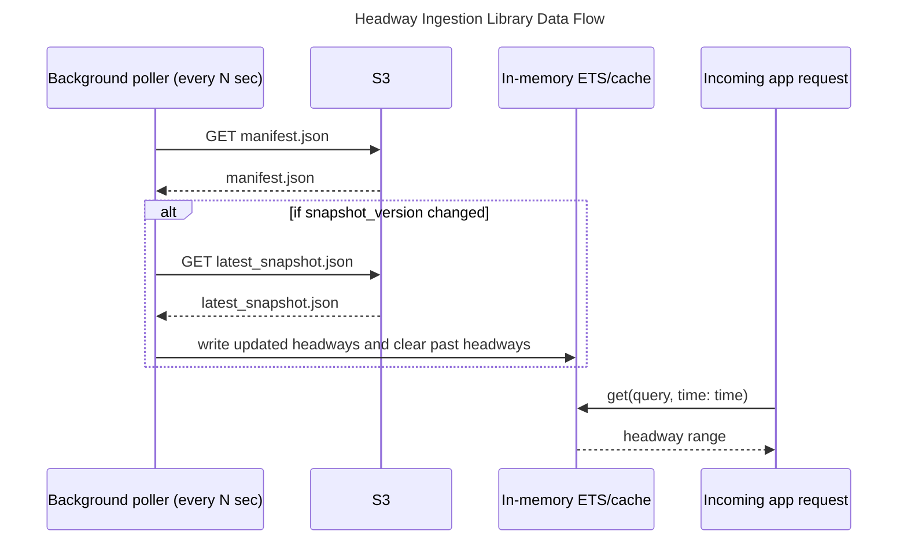

- Feature Name: `shared_headways_library`
- Start Date: 2026-09-30
- RFC PR: [mbta/technology-docs#0036](https://github.com/mbta/technology-docs/pull/0036)
- Asana task: [Shared Headways - Initial Architecture](https://app.asana.com/1/15492006741476/project/1185117109217413/task/1217000215475461)
- Status: Proposed

# Summary
[summary]: #summary

This proposal details the goals of and plan to create a Headways Elixir Library that calculates low and high time ranges, readable as "trains/buses every `low` to `high` minutes", from consumer-supplied schedules. Consumers can use a pure calculation API with their own storage, or opt into a managed runtime that coordinates refresh timing and caches calculated headways. In either mode, consumers own schedule retrieval from the V3 API.

# Motivation
[motivation]: #motivation

When there are no predictions for a subway route but service is running, we want to show headway information (i.e., “Trains every 8–14 min”). Headway display behavior is currently implemented on some screens, but we want to extend it to all screens, the website, and MBTA Go. Additionally, we want all of these touch points to behave consistently, both in terms of when and what headways they show.

We have scoped this Library to support the following goals for its launch:
- Provide one common mechanism for all Rider Tools applications to obtain service headway information for subway, light rail, and the Silver Line, so riders see consistent values regardless of channel.
- Replace the current need for OIOs to manually enter headway values with an automated, schedule-derived calculation.
- Headway values available by stop/platform and direction. At stops serving multiple destinations in the same direction, we show a combined headway ("Southbound trains every lo-hi min"), **unless** the touchpoint is specific to a platform that serves a single destination, like the Ashmont and Braintree platforms at JFK/UMass, in which case we show that destination's headway ("Ashmont trains every lo-hi min").
- Support both combined Green Line headways and separate headways for individual branches at shared stops. For example, Dotcom will be able to show D Branch headways on the Green Line D Branch departures page at Copley.

Overrides, fallback values, and shared rules for when headways should be shown are out of scope for launch.

# Proposal
[proposal]: #proposal

### Interface

The library will separate calculation policy from the schedule retrieval and storage lifecycle. It will expose a pure "bring your own data" (BYOD) API and an optional managed runtime, both using the same input contract and calculation logic. 

#### Pure calculation and lookup

Consumers will parse their source data into a list of schedule records and pass that list to `Headways.calculate_day/2` or `Headways.calculate_window/2`. `calculate_day/2` will calculate every effective window represented for the service day while `calculate_window/2` will calculate one explicit time window. The functions will not accept query knobs or require coverage metadata, but instead derive result keys from the supplied schedules' stop/platform, direction, and route fields. Consumers will own parsing and normalization, while the library will validate that the supplied schedules are compatible (for example, schedules with different `direction_id` values will produce a validation failure). This separation of concerns will allow consumers to calculate headways for either a specific branch (i.e. Green-B) or for multiple branches on the same line by filtering their schedule data passed to the library differently. The result will be a snapshot containing headway entries with effective start and end times and known no-service or insufficient-departure results. Calculation will not fetch data, start processes, or read the current clock implicitly.

```elixir
# Calculate every effective window represented in the parsed schedule list.
Headways.calculate_day(schedules, service_day)
#=> {:ok, snapshot} | {:error, reason}

# Calculate one explicit effective time window from the parsed schedule list.
Headways.calculate_window(schedules, time_window)
#=> {:ok, snapshot} | {:error, reason}

# Look up an entry in a previously calculated snapshot, without ETS or a process.
Headways.lookup(snapshot, %{parent_stop_id: "place-jfk", direction_id: 0, route_id: "Red"}, time: time)
#=> {:ok, {4, 7}} | {:error, reason}
```

A consumer will be able to calculate a full day's headways once, store the snapshot, and look up the applicable window on demand. Another will be able to calculate a single window on demand and store the result however it prefers. In both cases, the library will use the same absolute effective windows; an on-demand calculation will not use a rolling two-hour window starting at request time. Consumers managing their own storage will also own refresh scheduling, invalidation, and stale-data policy. Pure lookup will only select from the supplied snapshot; it will not detect that newer schedules exist.

#### Optional managed runtime

Consumers that want shared refresh scheduling and caching will configure a schedule-provider callback implemented within their application. The runtime will determine when data is needed and invoke the provider; the provider will retrieve schedules through the application's existing API client or schedule cache. The library will not take V3 API credentials or contain an HTTP client.

```elixir
# Configure a consumer-owned schedule provider.
# Creates ETS and returns immediately; initial provider loading and calculation run
# in the background. Until publication, get returns {:error, :not_loaded}.
# A provider failure never prevents the consumer application from starting.
# We may add options to define things such as the consumer’s schedule scope (i.e. how many time windows to cache)
Headways.start_link(schedule_provider: RealtimeSigns.HeadwaySchedules),

# Inspect load state, refresh health, schedule versions, and cache coverage.
Headways.status()

# Lookup types for fetching headway ranges from the cache
# Child platforms do not require explicit direction or route.
# For parent stations, we must explicitly select direction and normalized route.
@type query ::
        %{stop_id: String.t()}
        | %{
            parent_stop_id: String.t(),
            direction_id: 0 | 1,
            route_ids: [String.t()]
          }

# Tuple representing the low and high range of headways for a given lookup
@type range :: {low :: pos_integer(), high :: pos_integer()}

# Returns a single headway range. By default, returns the range for the current time.
@spec get(query()) :: {:ok, range()} | {:stale, range()} | {:error, reason}
@spec get(query(), opts) :: {:ok, range()} | {:stale, range()} | {:error, reason}
Headways.get(%{stop_id: stop_id})
Headways.get(%{stop_id: stop_id}, time: time)
Headways.get(%{parent_stop_id: parent_stop_id, direction_id: direction_id, route_ids: route_ids})
Headways.get(%{parent_stop_id: parent_stop_id, direction_id: direction_id, route_ids: route_ids}, time: time)

# If a consumer needs a per-route breakdown, we can have the following
@spec get_all(parent_stop_id, direction_id, opts) :: {:ok, %{route_id => range()}} | {:stale, %{route_id => range()}} | {:error, reason}
Headways.get_all(parent_stop_id, direction_id)

```

#### Startup configuration

Consumers will pass a `schedule_provider` to `Headways.start_link`. The provider will be a consumer module implementing the shared behaviour, with any provider-specific options supplied by that application. The pure calculation API will operate on parsed schedule lists without requiring a provider or route/platform query options.

#### Schedule input and provider contract
As in RFC 34, consumers will adapt their existing structs to a documented, simplified input format. The library will own validation and calculation, not application-specific API decoding. A schedule dataset will include:

- Scheduled departures with trip ID, child stop ID, original route ID, direction ID, and timezone-aware departure time. Parent station IDs are required for station aggregation, either on each departure or in a separate mapping keyed by child stop ID. The exact input schema will be finalized during implementation.
- The service date and service-day association for departures, including departures after midnight. For the managed runtime, the provider will also report explicit coverage: which routes, stations/platforms, and effective windows are complete. Full-day data will include the start and end of service; window-only data will cover the entire effective window, including the extended first or last window where applicable.
- Source metadata, including retrieval time and published schedule version when available. The provider must report the version actually represented by its data, not merely the latest version observed at the API.

Consumers will configure the managed runtime with a schedule provider and provider-specific options, but will not pass route or platform IDs to Headways at startup. When schedules are needed, the runtime will request data for the relevant service dates and effective windows. The provider will decide which schedules to retrieve, using its own configuration and the consumer’s existing data sources.

Headways will calculate and cache results for the coverage the provider supplies; it will not select routes or platforms to fetch. The calculation functions will receive only the schedule list (and, for `calculate_window/2`, the explicit time window), not provider coverage or selection options.

```elixir
@callback load(request :: %{service_dates: [Date.t()], windows: [window()]},
               opts :: keyword()) ::
            {:ok, schedule_data :: map()} | {:error, reason :: term()}```
```

This callback allows the library to coordinate refreshes without owning API access. A push-only API would not be sufficient, since the library would not be able to obtain fresh schedules when coverage expires. Consumers preferring to push data or manage their own lifecycle should use the pure API and their own storage.

#### Parent stations and platforms

Lookups accept either a child platform or a parent station query. Pure snapshot lookup accepts the same shapes.

- **Child platform:** `%{stop_id: stop_id}` infers direction and normalized route from the platform's schedule metadata. The range is calculated only from departures at that platform. Use this for touchpoints tied to a specific platform, such as PA/ESS screens.
- **Parent station:** `%{parent_stop_id: parent_stop_id, direction_id: direction_id, route_ids: route_ids}` calculates the range from departures for the selected normalized route in that direction across the station's platforms. Use this for touchpoints that describe the whole station.

At JFK/UMass, a parent-station lookup combines southbound Red Line departures, while child-platform lookups can return separate Ashmont and Braintree ranges:

```elixir
Headways.get(%{parent_stop_id: "place-jfk", direction_id: 0, route_ids: ["Red"]})
#=> {:ok, {4, 7}}

Headways.get(%{stop_id: "70085"})
#=> {:ok, {8, 13}}
```

Both Red Line destinations use the same `route_id`, so platform-specific lookups will provide their separate headways without introducing new route IDs. Separating destinations that share both a route ID and a platform would require another selector and will remain outside initial launch scope.

#### Failure handling and staleness

The following policy applies to the optional managed runtime. The library owns refresh coordination, deadlines, cache publication, and reporting degraded availability. The consumer's provider owns retrieval failures and bounded transport retries. Request-time lookups never fetch schedules or ask consumers to retry a network request.

##### Startup and refresh isolation

Startup will create an empty cache and start the initial provider load in the background. Until a complete dataset has been published, lookups will return `{:error, :not_loaded}`. Provider failures never block application startup, and lookups never wait for a load or trigger one themselves. Provider invocation and calculation will run in a supervised background worker, separate from the cache owner. A worker crash, provider error, or timeout leaves the active cache intact and is reported as a failed refresh. Only one refresh runs at a time, including manual refreshes; additional requests are coalesced into at most one follow-up refresh that re-evaluates current requirements rather than queued individually.

##### Lookup results and stale-data limits

The following policy applies to both `get` and `get_all`:

- `{:ok, value}` means the cache contains a calculated range for the requested effective window and the library has not detected a newer schedule version awaiting publication. A failed refresh alone does not invalidate an otherwise applicable range, although it means schedule changes may be undetected.
- `{:stale, value}` means the range belongs to a superseded schedule version or, when the requested window is missing because of a failed refresh, an earlier window. Consumers can explicitly choose whether to display this result.
- `{:error, :not_loaded}` means no initial dataset has been published.
- `{:error, :unavailable}` means no applicable result or permitted stale fallback is available after initial publication.
- `{:error, :no_service}` and `{:error, :insufficient_departures}` represent complete schedule coverage without a calculable range. These results must not be replaced with prior-window fallback. Pure snapshot lookup uses the same reasons and returns `{:error, :unavailable}` for missing coverage.

Stale fallback will be bounded by a library-level maximum age, measured from the effective window's end for prior-window fallback or from detection of a superseding version. As an example, during implementation, we may determine that either of going back to a previous day's headways for the same time or instead a window within the same service day proves most accurate. Consumers may suppress stale results but should not extend the library's limit.

##### Observability

The managed runtime will emit `:telemetry` events for refresh success, failure, and skipped refreshes where version checks and coverage show no update is needed. Metadata will include the failure stage and category, schedule version when available, and refresh duration, without API credentials or full response bodies. Transport retry telemetry belongs to the consumer's provider or existing API client. `Headways.status()` will expose load state, whether a refresh is running, the last successful publication time, applied and pending schedule versions (or unknown), source retrieval time, consecutive failures, and cache coverage. Consumers will own logging and alerting, particularly for failed initial loads, repeated failures, and coverage approaching exhaustion.

### ETS Cache Design
[ets-cache-design]: #ets-cache-design

The optional runtime stores calculated results in ETS by stop/platform, direction, route, and effective window. It prepares current and upcoming windows, atomically publishes complete cache generations, and retains source/coverage metadata for stale-result handling. Combined Green Line headways are calculated from merged branch departures.

A key for the ETS cache would be a tuple of `{stop_id, direction_id}` in the case of parent stations, or just the `stop_id` when looking up child platform IDs. The value for each key is a list, which can contain multiple entries for different routes and time windows.
    
The example below shows the value for the key `{"place-pktrm", 0}`. It includes two time windows for the to demonstrate how it may look when we are about to cross between time windows and have pre-emptively calculated and stored headways for the next window.
    
```elixir
[
    {
        route_ids: ["Red"],
        headway_lo_hi: {5, 8},
        time_start: "2026-09-30T07:00:00-04:00",
        time_end: "2026-09-30T09:00:00-04:00",
    },
    {
        route_ids: ["Red"],
        headway_lo_hi: {6, 10},
        time_start: "2026-09-30T09:00:00-04:00",
        time_end: "2026-09-30T11:00:00-04:00",
    },
    {
        route_ids: ["Green-B", "Green-C", "Green-D", "Green-E"],
        headway_lo_hi: {2, 4},
        time_start: "2026-09-30T07:00:00-04:00",
        time_end: "2026-09-30T09:00:00-04:00",
    },
        {
        route_ids: ["Green-B", "Green-C", "Green-D", "Green-E"],
        headway_lo_hi: {2, 4},
        time_start: "2026-09-30T09:00:00-04:00",
        time_end: "2026-09-30T11:00:00-04:00",
    }

] 
```


### Calculation Policy

We will generally be going with the approach outlined during earlier experimentation done before this RFC ([see Notion](https://app.notion.com/p/mbta-downtown-crossing/First-Pass-at-Headways-2e1f5d8d11ea80839400fb6a1c1caaef?source=copy_link)). The calculation logic within the library will do the following:

1. Validate consumer-supplied schedules and coverage for the selected service day or effective windows. The library defines windows in `America/New_York`, anchored to the service day rather than application startup or request time. These windows will be service_start-7AM, 7AM-9AM, 9AM-11AM, 11AM-1PM, 1PM-3PM, 3PM-5PM, 5PM-7PM, 7PM-9PM, 9PM-11PM, and 11PM-service_end. The first and last windows may extend beyond two hours. Departures after midnight must retain their service-day association, and timezone-aware boundaries must account for daylight saving time.
2. Group records by stop/platform, direction, and route, retaining the original Green Line branch IDs.
3. Select and merge scheduled departures for each configured parent station route or child platform. For combined `"Green"` entries, merge departures from the qualifying branches; for individual branch entries, use only departures from that branch.
4. Compute intervals between the departure time of consecutive departures.
5. Summarize intervals within defined time windows into a rider-facing range. Set a minimum floor value of 1 or 2 minutes.
6. Return results as effective periods in a snapshot. The managed runtime publishes that snapshot to ETS; pure API consumers choose how to store it or may calculate individual windows on demand using the same policy.
    
```elixir
defp headways(schedule_list, start_time, end_time) do
    schedule_list
    |> Enum.map(& &1.time)
    |> Enum.sort(DateTime)
    |> Enum.reject(&DateTime.before?(&1, start_time))
    |> Enum.reject(&DateTime.after?(&1, end_time))
    |> Enum.chunk_every(2, 1, :discard)
    |> Enum.map(fn [t1, t2] -> DateTime.diff(t2, t1, :minute) end)
    |> case do
      [] -> {:error, :insufficient_departures}
      intervals -> {:ok, Enum.min_max(intervals)}
    end
end
```

The managed runtime will use a shared wall-clock refresh cadence, not a timer relative to application startup. A candidate cadence is 15 minutes before each fixed window boundary (for example, 6:45AM for the 7AM window). It will also load immediately on startup and prepare the next service day before current coverage expires. It may invoke the provider's optional version callback, backed by the V3 API's `status` endpoint or the consumer's existing metadata. A changed version requires loading applicable schedules and recalculating covered windows. Initial load or missing upcoming coverage also requires provider loading and calculation even when the version is unchanged. A successful version check may skip loading only when the required coverage is already cached from that same version; without version support, the runtime loads on each refresh cadence. A failed version check is a failed refresh, not evidence that cached data is current.

This coordinates when data is prepared and which windows apply without requiring the library to call the API directly. The failure-handling policy above applies to both provider version checks and loads; a common cadence does not guarantee availability during outages or identical source versions across applications. Consumers using only the pure API own this scheduling themselves.

### Data Storage Details

How much data would we need to store all the discussed headway data in the optional managed runtime's ETS cache within an Elixir application? This estimate covers calculated headways, not raw schedules held by a consumer's provider.

Let’s do some quick math!

- **143 active station/route combinations** as a baseline (excluding individual Green Line branch entries and configured child platforms)
- **2 directions** per station/route (excluding terminals, but let’s leave them in to round up)
- In JSON, each entry is about ~300 bytes. In decoded Erlang, accounting for nested maps, integers, etc., the size increases. If we’re being pessimistic, we can estimate an increase to around **1.5 KB per entry**.
- **For a given time window,** we thus are only storing **450KB for parent station entries (rounded up).**

Even if we assume that we’ll be storing amounting to a full day of time windows at once to minimize the risk of stale date, that would increase this baseline to only 4.5MB. Requested branch and platform entries will add to this estimate, and the actual cache size will depend on each consumer's configuration. 

In conclusion, storing all headway data in ETS should be quite manageable.

### Implementation and Rollout Plan

1. Create a Headways repo in Github for the Shared Libary.
1. Define and approve the calculation and consolidation policy against representative subway,  light-rail, and Silver Line examples. 
1. Define the normalized schedule and coverage contract, implement the pure calculation and snapshot lookup APIs.
1. Add a Screens-owned schedule provider using its existing API infrastructure. Implement the optional managed runtime's refresh coordination, provider integration, and ETS caching for use by Screens.
1. Run new calculation in shadow mode against Screens' existing manual values to report differences.
1. Migrate to fully use the new library within the Screens application.
1. Migrate the other Rider Tools applications: Realtime Signs, Dotcom, and MBTA Go. Each application may adopt the managed runtime with its own provider or use the pure API with its existing storage and lifecycle.

### Testing
[testing]: #testing

Pure calculation and lookup tests will pass fixed parsed schedule lists and, for window calculations, an explicit time window, without any processes or network calls. Consumers using the managed runtime will also need a way to run their test suites without live provider calls or time-dependent data. The library will support this by:

- A config option, such as `refresh: false`, that starts the ETS table without scheduling provider calls, so the runtime can stay in the consumer's supervision tree during tests.
- An injectable schedule-provider behaviour, allowing tests to supply fixed datasets and simulate failures or version changes without an HTTP client.
- A test helper for seeding the cache with fixed headway entries, so consumers can control what the get functions return:

```elixir
Headways.Test.put(stop_id, direction_id, route_id: "Red", range: {5, 8})
Headways.Test.clear()
```

Alternatively, `Headways` could expose a behaviour for consumers to swap in a mock with `Mox` instead of the real module.

The library's own tests will use a fake provider and an injectable clock/timer mechanism to exercise startup, refresh deadlines, coalescing, atomic publication, stale limits, and recovery deterministically. They will verify that `calculate_day/2` and `calculate_window/2` produce identical results for the same schedules and corresponding windows, including service-day rollover, daylight saving transitions, window boundaries, incomplete coverage, no service, insufficient departures, and invalid mixed-direction inputs. Provider integration tests in each consumer will verify API filtering, pagination, parsing, version metadata, and bounded transport retries. The library itself will not test consumer HTTP clients.

# Drawbacks
[drawbacks]: #drawbacks

- We may see drift in the displayed headways as we publish updates to the library, since each application will independently ingest it as a dependency. That inconsistency is the main cost of choosing the simpler deployment model. It also means there is no built-in override mechanism without adding extra infrastructure or operational work.
- This could multiply V3 API load compared to centralized headway calculation, since applications or instances may independently request schedules. However, we will reuse application's existing schedule cache to reduce duplicate requests, meaning additional load should only come from realtime_signs, which doesn't currently fetch schedules.
- It could be harder to debug a case like "why did Screens and Dotcom show different values?" without shared logging.
- Consumers must implement and maintain a schedule adapter, and applications without an existing schedule cache must add retrieval support. Input completeness and freshness depend on that adapter honoring the shared contract.
- Matching library versions and effective windows will not guarantee identical results if consumers supply different schedule versions or incomplete inputs. Source and coverage metadata make differences diagnosable but cannot enforce cross-application synchronization.
- The optional managed runtime runs processes inside each adopting consumer's supervision tree. Pure API consumers avoid those processes but own scheduling, storage, invalidation, and stale-data policy themselves.

# Alternative Approaches
[alternatives]: #alternatives

## API Endpoint for Headways

An API-based design would provide a single authoritative implementation, immediate propagation of updates across all apps, and centralized observability and override handling. 

### Why not this approach?

This would be the right direction only if we expected a broader set of shared platform concerns, including centralized overrides, cross-channel timing control, or operational management that only a service layer can provide. For this RFC, those requirements are not sufficient to justify the added complexity.

## Hybrid Approach

A Hybrid approach would preprocess headway data, write it to a shared store, and then use a shared ingestion library in each Rider Tools app to fetch and cache the dataset locally. This would give us many of the benefits of a centralized system without making each application depend on a live runtime API. It would keep reads cheap and cacheable, and it would allow for consistent results and extensibility with overrides.

### Why not this approach?

The Hybrid model is attractive because it addresses the main weaknesses of a Shared Library: drift across applications and extensibility for overrides/defaults. However, it also requires more infrastructure and operational complexity than this initial effort needs. It introduces additional storage, deployment, and maintenance concerns, and it is a bigger commitment than the team needs to achieve the initial goals of this effort.

For this phase, the simplest model that still meets the goals is the Shared Library itself. It minimizes infrastructure overhead and lets each app use the same schedule-derived logic with its existing data infrastructure, while offering a shared cache strategy through the optional managed runtime. We believe that the incremental gains from a Hybrid system do not outweigh the operational cost in the near term.

# Prior art
[prior-art]: #prior-art

The main existing prior work to extract common functionality into a shared library has not yet been implemented but was proposed in [RFC 34](./accepted/0034-shared-line-diagram-implementation.md)

## V3 API Pattern from RFC 34
The accepted RFC 34 proposes a shared route branching library whose consumers retrieve V3 API data and adapt it to simplified input structures. This proposal follows that BYOD pattern: consumers supply schedules, and the shared library owns the domain calculation rather than API credentials, HTTP clients, or application-specific schedule structs.

Headways will also benefit from shared refresh timing and caching, but those responsibilities will not require library-owned API access. The optional managed runtime will invoke a consumer-owned provider when schedules are needed, then calculate and cache the results. This will let applications reuse their existing schedule retrieval and caching infrastructure without rebuilding refresh coordination. Applications that prefer their own lifecycle will be able to precompute daily snapshots with `calculate_day/1` or calculate individual effective windows with `calculate_window/2`.

The tradeoff is that consumers must supply adapters and honor the input coverage and freshness contract. `realtime_signs`, which does not currently fetch or cache schedules, will need to implement schedule fetching in its provider.

# Unresolved questions
[unresolved-questions]: #unresolved-questions

- What parts of the design do you expect to resolve through the RFC process before this gets merged?
- What parts of the design do you expect to resolve through the implementation of this feature
  - What shared maximum stale age should the managed runtime enforce before returning `{:error, :unavailable}`?
  - Will the Screens team own the Library after its release?
  - Is 1 minute a reasonable lower bound for headways, or should the minimum floor be 2 minutes?
  - How much of an impact do outliers have on the headway calculation for less frequent routes, such as GL and RL branches? Will we need to shorten the headway range windows to percentiles at a certain length of time threshold?


# Future possibilities
[future-possibilities]: #future-possibilities

## Extensions within a Shared Library
[extensions-within-a-shared-library]: #extensions-within-a-shared-library

### Representative Headway Values

We could add a JSON to the library that is strictly default values for headways by stop in the event of failures reaching the V3 API.

The argument to do this is in case of a hypothetical incident that affects both Predictions and Schedules from the V3 API. In this case, Rider Tools applications without applicable cached schedules or calculated headways would try to fall back to showing headways, but would not have the data to do so.

### Overrides
[overrides]: (#overrides)

We could create a UI with some light infrastructure, similar to Signs UI’s current headway value mechanism, which updates Headways in a JSON file accessible by all of the Rider Tools apps. We can then check the override file when updating the ETS cache with Headway values.

Overrides could also extend to overriding headways from being shown entirely. This behavior has been raised as having possible value given that there are times when we might be missing predictions and also believe that headways will be unreliable and frustrating to riders.

In order for these overrides to be reflected in real time, we may need additional infrastructure so that the Library picks up any such updates. For this to be achieved cleanly, we may need to extend beyond a library; see the Hybrid Architecture discussed below for further details.

## Hybrid Architecture as an Extension
[hybrid-architecture]: (#hybrid-architecture)

This is a breakdown of how a Shared Library could be extended to a Hybrid Architecture approach, which we discussed as an alternative approach earlier. Although this would require additional infrastructure setup and maintenance, we could keep it in mind for the future to improve the consistency between consumers and more easily enable extensions like overrides.

At a high level, the preprocessing job will calculate headways, write them to S3, and then each Rider Tools App will use a shared Ingestion Library to update headways in their own application. The following sections will go into more detail.

### Components



1. **Libraries:** The calculation half of this library is pure domain logic that accepts scheduled departures and produces a JSON snapshot and manifest. The Ingestion Library would be used by all Rider Tools app, and is described in more detail later in this doc.
2. **Preprocessing Job:** Runs on a set schedule or on GTFS changes and writes to S3. 
3. **S3 Storage:** A manifest plus versioned JSON snapshots in object storage. 

### Ingestion Policy

The shared client library will own fetching, manifest and snapshot parsing, schema validation, refresh polling, caching in ETS, and the `get` lookup. Applications will only need to configure the manifest URL, and perhaps some small options, like how often to poll the manifest. 



### Data Contract

The manifest is a tiny, frequently-overwritten pointer file that contains metadata about which snapshot is currently authoritative.

```json
{
  "schema_version": 1,
  "snapshot_version": "2026-09-17T120000Z",
  "snapshot_url": "headways/snapshots/2026-09-17T123456Z.json",
  "generated_at": "2026-09-17T12:34:56Z"
}
```

The snapshot JSON files will look like those discussed within the [ETS Cache Design](#ets-cache-design) of the Shared Library.

#### Versioning and Breaking-Change Strategy

Three independent version axes avoid forcing synchronized upgrades.

- `snapshot_version`: which data (changes continuously)
- `schema_version`: shape of the JSON (changes rarely)
- `library_version`: parser code (semver; tracks schema support)

We will follow these proposed rules:

1. Parsers ignore unknown fields; adding optional fields is a `snapshot_version`only change.
2. Required-field changes require a new `schema_version`, published at a distinct path like `headways/v2/latest.json` alongside the old one.
3. The writer dual-publishes old and new schema versions until all known consumers have migrated.
4. Client library major versions track schema support windows (i.e. `1.x` parses schema 1 only; `2.x` parses schema 1 and 2; `3.x` drops schema 1 after migration completes)
5. A client encountering an unsupported `schema_version` fails closed and continues serving its last known good snapshot rather than crashing or parsing incorrectly.
